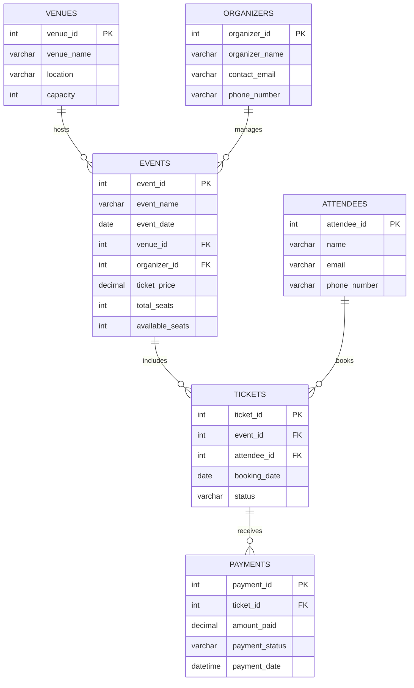

<div align="center">


<br/>

<a href="https://github.com/PalAnghan">
  
</a>

<br/>


<br/><br/>

<a href="#about">About</a> •
<a href="#features">Features</a> •
<a href="#database-design">Database</a> •
<a href="#sql-topics">SQL Topics</a> •
<a href="#run-the-project">Run Project</a> •
<a href="#developer">Developer</a>

</div>

---

<a id="about"></a>
## 📌 About

**Smart Event Management System** is a MySQL database project created as part of my final practical examination.

The project organizes information about events, venues, organizers, attendees, ticket bookings, and payments. It demonstrates relational database design and practical SQL queries, from basic CRUD operations to joins, subqueries, and window functions.

## ✨ Features

- 🎫 Manage event details, dates, ticket prices, and seat availability.
- 🏢 Store venue names, locations, and capacities.
- 👥 Maintain organizer and attendee information.
- 🎟️ Track ticket bookings and booking statuses.
- 💳 Store payment amounts, dates, and payment statuses.
- 📊 Generate reports using SQL queries and aggregate functions.
- 🔗 Connect related records using primary and foreign keys.
- 🧠 Practise advanced SQL with subqueries, window functions, and CASE expressions.

## 🧰 Tech Stack

| Technology | Purpose |
|---|---|
| MySQL 8.0+ | Database management |
| SQL | Database queries and operations |
| Visual Studio Code | Writing the SQL script |
| MySQL extension/client | Executing queries |

<a id="database-design"></a>
## 🗄️ Database Design

Database name: `event_management`

The project contains six main tables:

| Table | Description |
|---|---|
| `venues` | Venue name, location, and capacity |
| `organizers` | Organizer names and contact details |
| `events` | Event date, venue, organizer, ticket price, and seats |
| `attendees` | Attendee names and contact details |
| `tickets` | Event bookings, attendees, booking dates, and status |
| `payments` | Ticket payment amount, payment status, and date |

### Entity Relationship Diagram



### Relationships

- One venue can host multiple events.
- One organizer can manage multiple events.
- One event can have multiple ticket bookings.
- One attendee can book tickets for multiple events.
- A ticket can be associated with payment records.

<a id="sql-topics"></a>
## 📚 SQL Topics Covered

This project covers all 12 practical topics:

| # | Topic | Concepts |
|---:|---|---|
| 01 | CRUD Operations | `INSERT`, `SELECT`, `UPDATE`, `DELETE` |
| 02 | SQL Clauses | `WHERE`, `HAVING`, `LIMIT` |
| 03 | SQL Operators | `AND`, `OR`, `NOT`, `IN` |
| 04 | Sorting & Grouping | `ORDER BY`, `GROUP BY` |
| 05 | Aggregate Functions | `SUM()`, `AVG()`, `MAX()`, `MIN()`, `COUNT()` |
| 06 | Key Relationships | Primary key, foreign key, unique constraint |
| 07 | Joins | `INNER`, `LEFT`, `RIGHT`, `FULL OUTER JOIN` equivalent |
| 08 | Subqueries | Nested queries, `IN`, aggregate subqueries |
| 09 | Date & Time | `MONTH()`, `DATEDIFF()`, `CURDATE()`, `DATE_FORMAT()` |
| 10 | String Functions | `UPPER()`, `TRIM()`, `IFNULL()` |
| 11 | Window Functions | `RANK()`, `SUM() OVER()`, `COUNT() OVER()` |
| 12 | CASE Expressions | Conditional event demand and payment labels |

## 💻 Sample SQL Queries

**1. Display all events**

```sql
SELECT * FROM events;
```

**2. Calculate average ticket price**

```sql
SELECT AVG(ticket_price) AS average_ticket_price
FROM events;
```

**3. Display events with venue information**

```sql
SELECT e.event_name, v.venue_name, v.location
FROM events e
INNER JOIN venues v
ON e.venue_id = v.venue_id;
```

**4. Find events priced above the average**

```sql
SELECT *
FROM events
WHERE ticket_price > (
    SELECT AVG(ticket_price)
    FROM events
);
```

**5. Rank events by successful payment revenue**

```sql
SELECT t.event_id,
       SUM(p.amount_paid) AS total_revenue,
       RANK() OVER (
           ORDER BY SUM(p.amount_paid) DESC
       ) AS event_rank
FROM tickets t
JOIN payments p
ON t.ticket_id = p.ticket_id
WHERE p.payment_status = 'Success'
GROUP BY t.event_id;
```

<a id="run-the-project"></a>
## 🚀 Run the Project

### Requirements

- MySQL Server 8.0 or later.
- Visual Studio Code with a MySQL extension, MySQL Workbench, or another MySQL client.

### Step 1 — Clone the repository

```bash
git clone https://github.com/PalAnghan/Smart_Event_Management_System.git
```

### Step 2 — Open the project

Open the downloaded folder in Visual Studio Code.

### Step 3 — Execute the SQL file

Open `event_management.sql`, connect to your MySQL server, and execute the script.

### Step 4 — Verify the database

```sql
USE event_management;
SHOW TABLES;
```

## 📁 Project Structure

```text
Smart_Event_Management_System/
│
├── event_management.sql
└── README.md
```

## 🎯 What I Learned

- Designing relational databases with multiple connected tables.
- Creating tables and inserting sample records.
- Applying primary key, foreign key, and unique constraints.
- Writing queries for filtering, sorting, and reporting.
- Using joins and subqueries to retrieve related information.
- Applying aggregate, date, and string functions.
- Analysing records with window functions and CASE expressions.

> **Sample data note:** The supplied event dates are from 2024. Queries using `CURDATE()` to find upcoming events may return no rows with this sample data. Update the dates to test upcoming-event queries.

---

<a id="developer"></a>
## 👨‍💻 Meet the Developer

<div align="center">

<a href="https://github.com/PalAnghan">
  
</a>

### Pal Anghan

**BCA Graduate | Aspiring Developer**

*Building projects, exploring technology, and learning something new every day.*

<a href="https://github.com/PalAnghan">
  
</a>
<a href="https://github.com/PalAnghan?tab=repositories">
  
</a>

<br/><br/>


</div>

---

<div align="center">

**Thanks for visiting! ⭐**

*Made with 💙, MySQL, and a lot of practice.*

</div>
